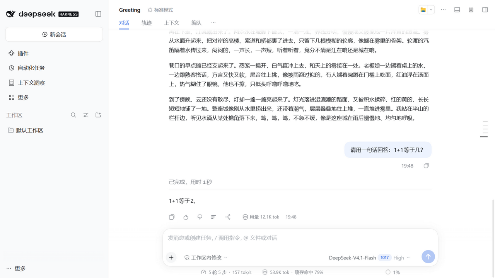
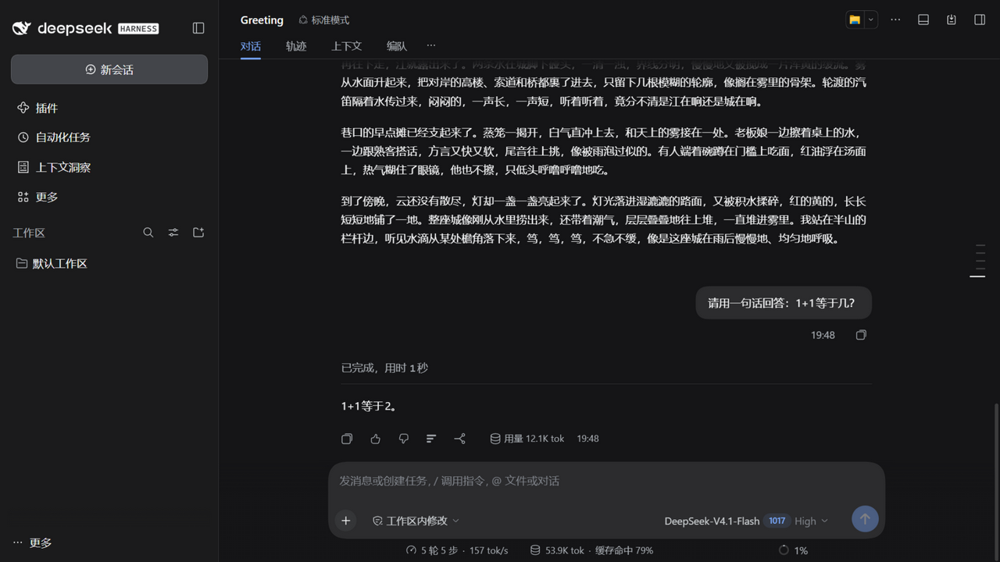
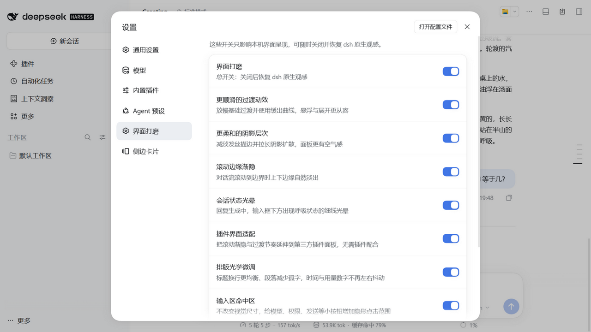
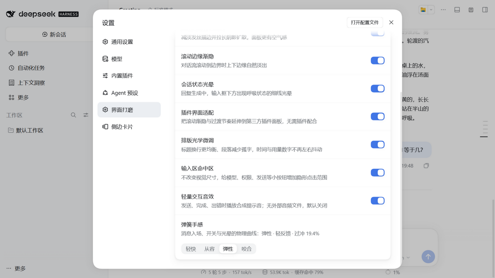

# dsh-ui-polish

[简体中文](README.md) · **English**

[](LICENSE)
[](https://github.com/deepseaandhighsky-arch/dsh-ui-polish)
[](https://github.com/deepseek-ai/deepseek-harness)

A **dsh-native UI polish plugin**. It improves motion, elevation, scroll edges, status feedback, typography and third-party plugin surfaces **on top of dsh's own design language** — without changing layout, information architecture, navigation, or the host brand.

> Built for [DeepSeek Harness](https://github.com/deepseek-ai/deepseek-harness) (dsh). dsh is in developer preview; this plugin targets the `0.2.x` line.

## Features

| Group | What it does |
|---|---|
| **Motion** | 0.12/0.24/0.36s transitions with CDS `easeSwift`; spring-based message entrance (last 12 flow nodes only) |
| **Elevation** | Dual-layer ambient/diffusion shadows, dark inset chamfer, 10%/9% hairline stroke |
| **Scroll fades** | 28px, 7-stop nonlinear edge fade (15/30/45/60/75/87/100%); `scroll-padding` follows the fade |
| **Status glow** | 1.8s breathing aura + 1.1s sweep for the composer; 1.8s ring on the reasoning separator |
| **Plugin adaptation** | Auto-discovers third-party scrollports; read-only shadow stylesheet scales `transition-duration` by 1.2× |
| **Typographic optics** | `text-wrap: pretty/balance`, `tabular-nums`, dark variable-font weight 390, optical sizing, link underline optics |
| **Composer hit areas** | Invisible 5px/2px hit-area expansion on 22–34px composer controls; visual size unchanged |
| **Interaction sounds** | Optional synthesized send/done/error cues; no audio files; **off by default** |

**Spring profiles**: Snappy 0.22s (8.8% overshoot), Gentle 0.35s (1.8%, default), Bouncy 0.58s (19.4%), Heavy 0.32s (zero overshoot). They apply to plugin-owned motion only, not host button transitions.

Settings live in **Settings → UI Polish** (`界面打磨`), a dedicated `settings.section` sibling of General. Preferences are local to the browser and apply instantly.

## Install

The package is not published to npm yet. Build from source:

```bash
git clone https://github.com/deepseaandhighsky-arch/dsh-ui-polish.git
cd dsh-ui-polish
npm install
npm run build

# Install into a dsh profile (absolute path)
dsh plugin --profile web add file:/abs/path/to/dsh-ui-polish

# Development: link the working tree
dsh plugin --profile web add link:/abs/path/to/dsh-ui-polish
```

Restart `dsh web` after installing. The plugin cleans up its stylesheet, token overrides, slot registrations, listeners and AudioContext on unload.

### Isolated testing

dsh supports redirecting all state through `DSH_HOME`:

```bash
mkdir -p .testenv/dsh-home
DSH_HOME="$PWD/.testenv/dsh-home" npx dsh web --port 3311 --no-open
```

This repository's own verification always runs in an isolated `DSH_HOME`; the plugin never writes to a production profile.

## Screenshots

| Light conversation | Dark conversation |
|---|---|
|  |  |

| UI Polish settings (light) | Spring profile + sound (optional state) |
|---|---|
|  |  |

More: [dark settings](docs/screenshots/v040-settings-section-dark.png) · [dsh-context panel](docs/screenshots/v040-context-panel-dark.png).

## Compatibility

- dsh `>=0.2.0 <0.3.0`; verified on `0.2.1-rc.5`.
- Coexists with dsh-context `0.78.0` and dsh-better-sidebar `0.28.2`.
- Node `>=20`.
- dsh is a developer preview; re-verify after dsh upgrades.

## Safety & permissions

- **No network requests, telemetry, analytics, or remote assets.** All sounds are synthesized with Web Audio; fonts/icons are not bundled.
- **Local preferences only**: `localStorage` key `dsh-ui-polish.v1`.
- **Read-only host integration**: token overrides via the official `ctx.theme.overrideTokens`; plugin stylesheets are parsed read-only into a separate shadow stylesheet; the plugin never mutates another plugin's CSSOM or dsh's source.
- **Reversible**: the master switch removes fades, the shadow stylesheet, token overrides and audio; each group can be disabled independently.
- **No layout takeover**: no changes to panel positions, navigation, density or information architecture; the plugin only adjusts visual/interaction details.

## Development

```bash
npm install
npm test            # 55 tests
npx tsc --noEmit
npm run build       # lib/client.js (IIFE, dsh client module format)
npm run pack:check
```

Project docs:

- [`AGENTS.md`](AGENTS.md) — contributor guide and hard constraints.
- [`docs/README.md`](docs/README.md) — docs/screenshot index.
- [`docs/PROJECT-ASSETS.md`](docs/PROJECT-ASSETS.md) — asset inventory and tech debt.
- [`docs/research/CDS-ASSET-MAP.md`](docs/research/CDS-ASSET-MAP.md) — which reference assets were adopted/adapted/rejected.
- [`docs/research/UX-DIFF-REPORT.md`](docs/research/UX-DIFF-REPORT.md) — with/without-plugin UX report.
- [`CHANGELOG.md`](CHANGELOG.md) — release notes.

## Acknowledgments

This plugin exists because of these open-source projects:

- **[open-claude-ui](https://github.com/Caho1/open-claude-ui)** (MIT) — a community study of Claude Desktop's design system. Its reverse-engineered parameters informed the 7-stop fade, spring presets, glow timings and typographic optics. Only ideas/parameters were referenced; no Anthropic brand assets or source code are included.
- **[DeepSeek Harness](https://github.com/deepseek-ai/deepseek-harness)** (MIT) — the host platform, token system, Slot contracts and isolated test workflow.
- **[dsh-context](https://github.com/bowenliang123/dsh-context)** (Apache-2.0) — third-party plugin structure/token-consumption reference and coexistence test target.
- **[DSH-better-sidebar](https://github.com/omdsh-dev/DSH-better-sidebar)** (MIT) — third-party surface reference and transition-retiming test target.

Full license notes: [`THIRD_PARTY_NOTICES.md`](THIRD_PARTY_NOTICES.md).

## License

[MIT](LICENSE) © 2026 dsh-ui-polish contributors

`dsh-ui-polish` is an independent community project, not affiliated with or endorsed by Anthropic, DeepSeek, or the referenced projects.