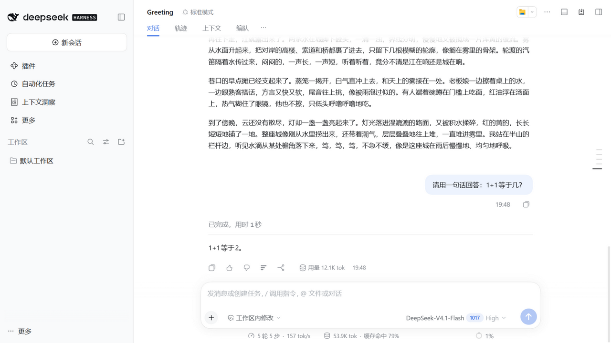
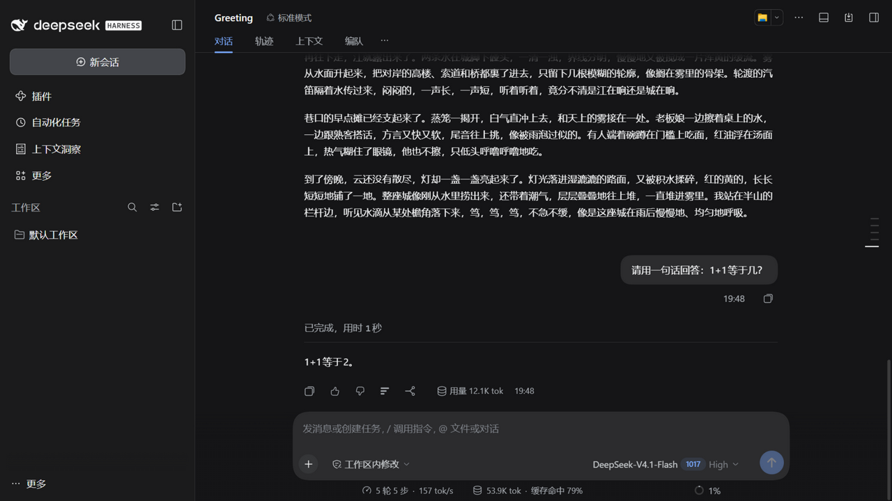
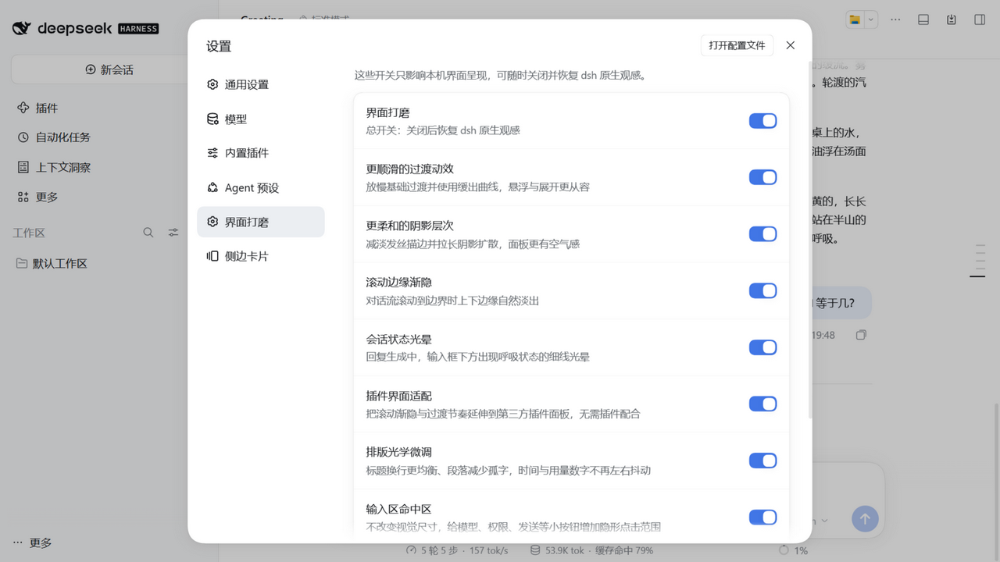
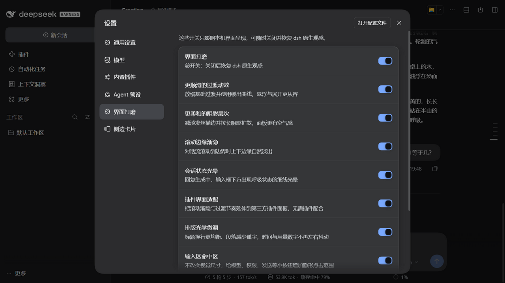
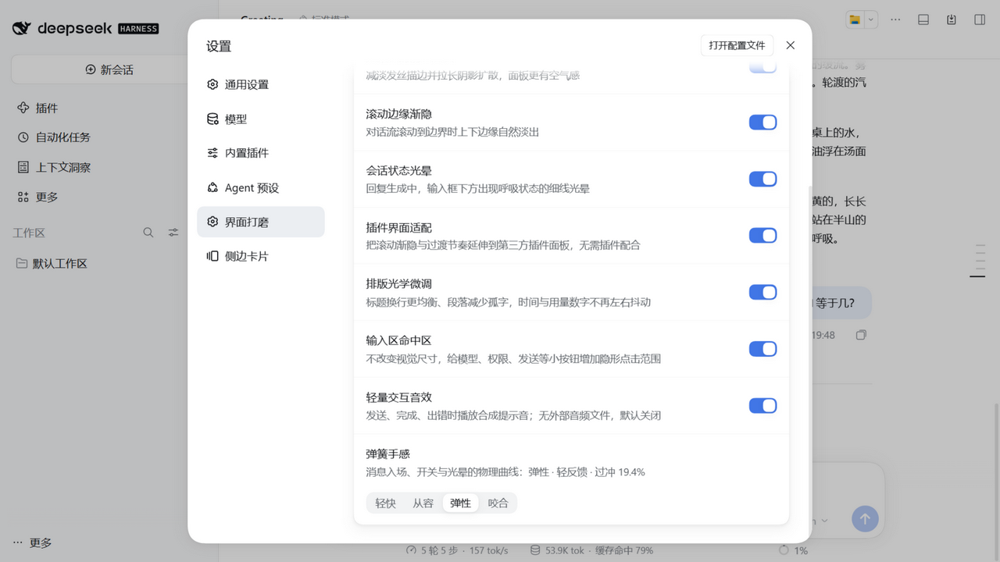
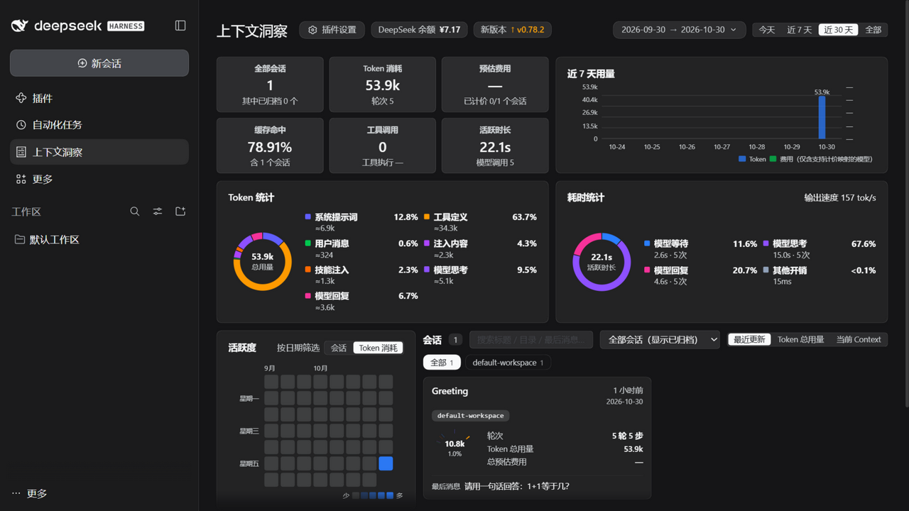
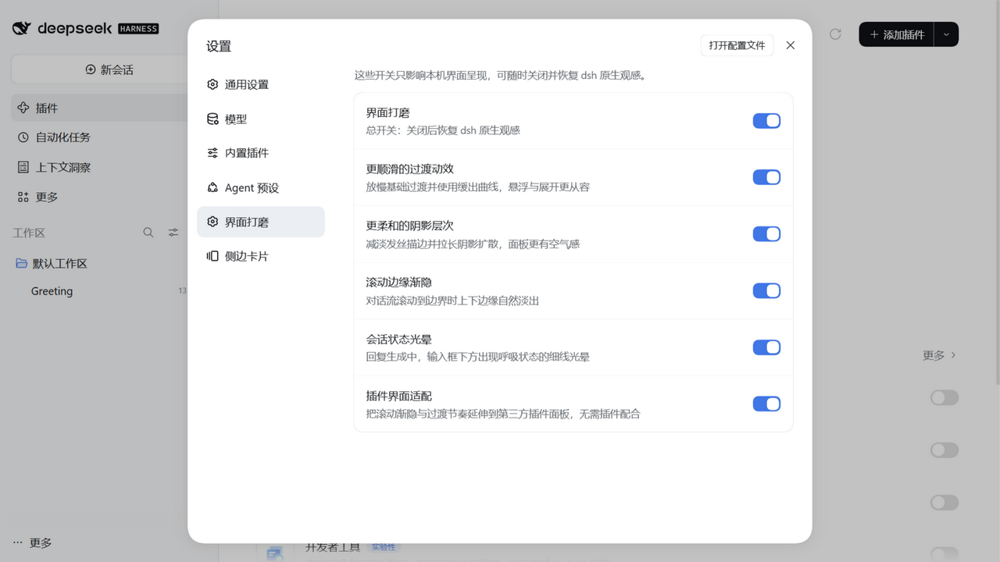
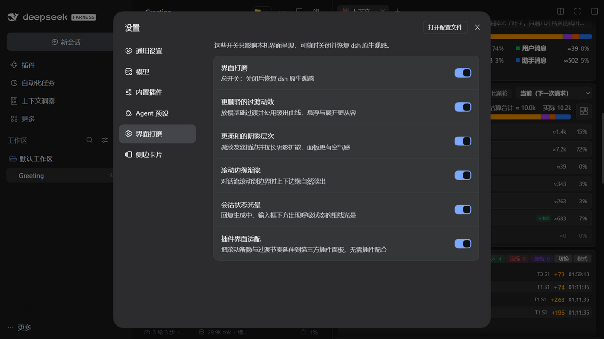

# dsh-ui-polish — dsh 原生 UI 设计优化插件

**简体中文** · [English](README.en.md)

[](LICENSE)
[](https://github.com/deepseaandhighsky-arch/dsh-ui-polish)
[](https://github.com/deepseek-ai/deepseek-harness)

在 [DeepSeek Harness](https://github.com/deepseek-ai/deepseek-harness) (dsh) Web 界面的**原生设计语言之上**做观感与交互打磨。不改框架布局、不引入新品牌色、不复刻任何第三方客户端外观——所有优化都构建在 dsh 自己的 `--dsw-*` / `--ds-*` 设计令牌体系与 Slot 插件系统之上。

本插件只做**视觉、交互与性能**优化，不改变 UI 分布、信息架构与导航结构；参考竞品时只借光学/物理/密度思路，不搬皮肤与布局。

技术思路部分借鉴 [open-claude-ui](https://github.com/Caho1/open-claude-ui) 逆向的**交互物理学与排版光学**（滚动羽化、动效曲线、状态光晕、发丝边、等宽数字），但全部重写为 dsh 风格，视觉皮肤完全保持 dsh 原生。逐项资产对照见 [`docs/research/CDS-ASSET-MAP.md`](docs/research/CDS-ASSET-MAP.md)。

## 功能（八组独立开关 + 总开关 + 弹簧档位）

| 分组 | 优化内容 | 实现通道 |
|---|---|---|
| **更顺滑的过渡动效** | 基础过渡时长 0.12/0.24/0.36s，缓动换为 CDS `easeSwift`（`cubic-bezier(.16,1,.3,1)`）；新消息以弹簧曲线消融入场（仅最后 12 个流节点，翻页不重播） | `ctx.theme.overrideTokens` + 自有 CSS 关键帧 |
| **更柔和的阴影层次** | CDS 式「近距遮蔽 + 远距扩散」双层阴影；深色表面加内侧顶光倒角；发丝描边对齐 10%/9% 透明带 | `ctx.theme.overrideTokens` |
| **滚动边缘渐隐** | 对话流离开边界时出现 **28px、7 档非线性**羽化遮罩（15/30/45/60/75/87/100%），消除高 DPI 色阶断层 | `mask-image` 直贴 scrollport + 滚动状态桥接 |
| **会话状态光晕** | 生成中：输入框下方 1.8s 呼吸光晕 + 1.1s 扫光；推理分隔点同步 1.8s 光环；出错转静态错误色 | `conversation.composer.dock` Slot + `useChat` 快照选择器 |
| **插件界面适配** | 把渐隐与过渡节奏延伸到第三方插件：自动发现插件滚动面板；读取插件样式表生成 1.2× 时长的影子表（不改插件 CSSOM） | 运行时发现引擎 + 影子样式表 |
| **排版光学微调** | 标题 `text-wrap: balance`、段落 `text-wrap: pretty`（减少末行孤字）、时间/用量/代码 `tabular-nums`、暗色可变字体 `font-weight 390`、链接下划线光学偏移 | 纯 CSS，按 dsh 稳定 `data-*` 标记作用 |
| **输入区命中区** | 模型/权限/添加/发送/统计等 22–34px 小控件增加 5px/2px 隐形命中区，视觉尺寸不变 | 纯 CSS `::after`，作用于 `[data-composer-seat]` |
| **轻量交互音效** | 发送、完成、出错三声合成提示音；Oscillator + Gain 包络，无外部音频文件；**默认关闭**，首次手势解锁 AudioContext | Web Audio API（`src/audio/sfx.ts`） |

**弹簧档位**（独立于分组开关，位于设置页底部）：轻快 0.22s（过冲 8.8%）、从容 0.35s（1.8%，默认）、弹性 0.58s（19.4%）、咬合 0.32s（零过冲）。作用于消息入场、设置开关与光晕入场，不覆盖宿主按钮过渡。

开关位于 **设置 → 界面打磨**（一个与「通用设置」并列的独立分区，通过官方 `settings.section` 注册），偏好存于浏览器本地，即时生效、无需刷新。

## 安装

要求 dsh `>=0.2.0 <0.3.0`。

### 从 GitHub 仓库安装（推荐）

dsh 的插件页支持 **npm 包、Git 仓库和本地目录**。在 **插件 → 安装第三方插件** 中输入发布包 tag：

```text
https://github.com/deepseaandhighsky-arch/dsh-ui-polish#v0.4.1-dist
```

或 GitHub 简写：

```text
github:deepseaandhighsky-arch/dsh-ui-polish#v0.4.1-dist
```

`v0.4.1-dist` 只包含发布包（约 33 KB，含预构建 `lib/client.js`），不会下载 `main` 分支里的源码、截图和文档；安装时**不需要** `allowBuilds` 或构建脚本授权。`main` 是完整源码仓库（约 4 MB），直接用 `github:.../dsh-ui-polish` 会下载整仓库，网络慢时容易卡住。

CLI 等价命令：

```bash
dsh plugin --profile web add github:deepseaandhighsky-arch/dsh-ui-polish#v0.4.1-dist
```

安装后按提示重启 `dsh web`。

### 从本地源码安装

```bash
git clone https://github.com/deepseaandhighsky-arch/dsh-ui-polish.git
cd dsh-ui-polish
npm install
npm run build

# 从本地目录安装（路径必须为绝对路径）
dsh plugin --profile web add file:/abs/path/to/dsh-ui-polish

# 开发模式：实时链接（改代码后重新 build 即可，无需重装）
dsh plugin --profile web add link:/abs/path/to/dsh-ui-polish
```

插件自带卸载清理：卸载或热重载时，样式表、令牌覆盖、Slot 注册与滚动监听全部随插件 fiber 自动回收。

**隔离测试**：dsh 支持用 `DSH_HOME` 环境变量重定向全部状态，可与生产环境完全隔离：

```bash
DSH_HOME=/tmp/dsh-test dsh web --port 3311 --no-open
```

## 从源码构建

```bash
npm install
npm run build     # tsdown → lib/client.js（单文件 IIFE，dsh 客户端模块表格式）
npm test          # vitest，55 个单元测试
```

## 技术设计

### 三通道注入

1. **令牌层**：通过 dsh 原生的 `ctx.theme.overrideTokens` 注册覆盖层（ThemePresenter 以内联样式写入 `<body>`，明暗双方案强制成对，主题切换自动保持）。不与任何样式表打架，是官方认可的第三方主题接入点。所有消费令牌的第三方插件（如 dsh-context 的 66 处过渡）会自动跟随。
2. **Slot 层**：
   - `conversation.composer.dock`（官方文档推荐的第三方席位）注入状态光晕；
   - `settings.section`（与内置分区同级的官方席位）注入独立的「界面打磨」设置页。
3. **运行时引擎层**（无需插件配合）：
   - **滚动渐隐引擎**：按几何与计算样式发现滚动容器，写入 `data-polish-fade-*` 状态，由 `mask-image` 呈现；对话容器走 `native` 作用域（受 fades 组控制），其余面板走 `plugin` 作用域（受 plugins 组控制）。
   - **过渡重定时引擎**：只读第三方插件样式表的声明，生成自有影子表（复制选择器与 at-rule 上下文，1.2× 时长），不修改插件 CSSOM；关闭第 5 组即整表移除。

### 从 open-claude-ui 移植的技术

| 来源资产 | 本插件中的对应 | 说明 |
|---|---|---|
| 7 档非线性 Alpha 遮罩 + 28px `scroll-fade-size` | 滚动边缘渐隐 | 由 `ScrollFadeContainer` 的 React 实现改为 dsh 原生同款 `mask-image` 直贴 scrollport，并把目标从对话流泛化到任意面板滚动容器；宿主不支持 `scroll(self)` 时间线，故用属性驱动 |
| `message-fade-up` / `timeline-block-enter` | 新消息入场 | 0.3s `easeEnter`，限定最后 12 个 flow 节点，避免翻页重播 |
| `wl-glow` / `epitaxy-linear-sweep` / `cds-dot-pulse` | 状态光晕 | 1.8s 呼吸 + 1.1s 扫光 + 推理点 1.8s 光环；色相改用 dsh 强调色 |
| CDS 4 层环境光阴影 + 深色倒角高光 | 阴影令牌 | 保留 dsh 的明暗表面，只重写 `--dsw-shadow-lv1/2/3` 与发丝描边 |
| 4 档 Framer 弹簧 | 弹簧档位、消息入场、设置开关、光晕入场 | 由二阶阻尼振子采样成 CSS `linear()`；只在插件自有动效上使用，不覆盖宿主按钮过渡 |
| Web Audio 合成音效 | 发送/完成/出错提示 | Oscillator + Gain 包络；默认关闭，首次手势解锁；AudioWorklet 因无持续音频流而不采用 |
| 触控负边距补偿 | 输入区命中区 | `[data-composer-seat] button::after` 外扩 5/2px，视觉尺寸不变 |
| `easeSwift` / `easeEnter` / `easeSweep` / 5 阶时长 | 动效令牌与自有动画 | 常量集中在 `src/motion/spring.ts`，CSS 与令牌层共用一份 |
| `text-wrap: pretty/balance`、`tabular-nums`、暗色字重补偿、`font-optical-sizing` | 排版光学组 | 只作用于 dsh 稳定的 `data-chat-flow-*` / `data-clock` / `data-composer-stat` 等标记 |
| 触控负边距补偿 | 设置开关命中区 | `::before` 外扩 10/8px，视觉不变，命中区 52×40 |
| `useClaudeScrollPinning` | `useScrollPinning` | 滚动钉住 hook（`src/motion/`）。**dsh 原生已内置等价的 ScrollFollow 与回底按钮**，故未接入 UI，仅作为动效库保留并测试 |

完整“采用 / 适配 / 不采用”矩阵见 [`docs/research/CDS-ASSET-MAP.md`](docs/research/CDS-ASSET-MAP.md)。

### 合规性

- 组件样式只用 `--dsw-alias-*` / `--dsw-*` 语义令牌与 `--ds-*` 运动令牌，无字面品牌色
- 遵守 `prefers-reduced-motion`（光晕降级为静态色；消息入场不注入；影子样式表整表包裹在 `no-preference` 内）
- 所有资源经 `ctx.effect` 注册，随插件卸载自动清理
- 定位不读插件组件源码：滚动目标靠几何 + 计算样式发现；动效适配只读取插件注入样式表的声明（只读），生成我们自己的影子表，不修改其 CSSOM
- 编辑器与终端（CodeMirror / Monaco / xterm / textarea / contenteditable）不参与渐隐；任意元素可用 `data-polish-fade="off"` 单点退出
- 只重定时 `transition-duration`，不触碰 `animation-*`；含 `var()`、`0s`、`calc()`、超过 1.2s 的声明跳过
- 不改变控件尺寸、圆角、间距、面板位置或导航结构；排版组只改换行与数字字形
- UI 文案为中文，与 dsh 产品文案约定一致

## 安全与权限

- **无网络请求、无遥测、无远程资源**：音效全部由 Web Audio 合成，不加载字体/图标/音频文件。
- **只写本地偏好**：`localStorage` key `dsh-ui-polish.v1`。
- **只读宿主**：令牌通过官方 `ctx.theme.overrideTokens`；第三方样式表只读解析并生成独立影子表，不修改其它插件 CSSOM 或 dsh 源码。
- **可逆**：总开关会移除渐隐、影子表、令牌覆盖与音效；每组可独立关闭。
- **不接管布局**：不修改面板位置、导航、密度或信息架构，只调整视觉/交互细节。

## 兼容性

- dsh `>=0.2.0 <0.3.0`；在 `0.2.1-rc.5` 上验证。
- 与 dsh-context `0.78.0`、dsh-better-sidebar `0.28.2` 共存验证。
- Node `>=20`。
- dsh 处于 developer preview，升级后需要重新验证。

## 功能预览

### 0.4.0（隔离环境实测）

| 场景 | 截图 |
|---|---|
| 会话流（浅色，28px 七档渐隐 / 消息排版 / 输入区） |  |
| 会话流（暗色，暗色字重补偿 / 双层阴影） |  |
| 独立设置分区「界面打磨」（浅色，总开关 + 8 组） |  |
| 独立设置分区「界面打磨」（暗色） |  |
| 设置页底部：轻量交互音效 + 弹簧档位（截图时为「弹性」+ 音效开启，展示可选状态） |  |
| dsh-context 面板（plugin scope 渐隐 / 第三方适配） |  |

### 0.2.0（历史）

| 场景 | 截图 |
|---|---|
| 独立设置分区「界面打磨」（浅色，与「通用设置」并列） |  |
| 独立设置分区「界面打磨」（暗色，明暗自适应） |  |
| 对话流滚动渐隐（0.2.0 的 24px mask） |  |
| dsh-context 面板滚动渐隐（`.lc-root`，与对话流同一引擎） |  |

> 0.1.0/0.3.0 截图未随公开仓库发布：0.1.0 部分历史截图包含本地路径，0.3.0 未单独保留；其视觉变化已被 0.4.0 覆盖。0.4.0 的量化差异见 [`docs/research/UX-DIFF-REPORT.md`](docs/research/UX-DIFF-REPORT.md)。

## 验证结果（dsh 0.2.1-rc.5 隔离环境实测，含 dsh-context + dsh-better-sidebar 共存）

| 验证项 | 结果 |
|---|---|
| 插件加载（`__DSH_BOOT__` entries 含 dsh-ui-polish） | ✅ |
| 样式表注入与卸载清理 | ✅ |
| 独立设置分区「界面打磨」与「通用设置」并列；分区内 9 个开关（总开关 + 8 组）+ 1 个弹簧档位；通用设置内 0 个打磨行 | ✅ |
| 令牌覆盖生效（0.24s / `cubic-bezier(.16,1,.3,1)` / 描边 `#ffffff14` / 双层阴影） | ✅ |
| 28px 七档渐隐：mask 16 个颜色停止点（7 档 alpha），顶部 28px 时位置为 4.2/8.4/12.6/16.8/21/24.36/28px | ✅ |
| 泛用渐隐发现：对话容器（native）+ dsh-context `.lc-ov-pagescroll`（plugin）自动打标；插件面板底部 28px | ✅ |
| 过渡重定时 A/B：better-sidebar `.12s/.15s → .144s/.18s`；关闭第 5 组回 `.12s/.15s` | ✅ |
| 令牌过渡不二次缩放：dsh-context `.lc-jump` 保持 `0.24s` | ✅ |
| 流式光晕：1.8s 呼吸 + 1.1s 扫光 + 推理点 1.8s 光环同时运行；结束后全部回 `none` | ✅ |
| 排版光学：`textWrap=pretty`、`[data-clock] tabular-nums`、暗色正文 `font-weight 390`；关闭 optics 后回 `wrap/normal/400` | ✅ |
| 弹簧档位：4 档可选并持久化；切到「弹性」后 `data-polish-spring=bouncy`，开关 `0.58s`、timing 含峰值 `1.1926` | ✅ |
| 音效：默认关闭；开启后 `AudioContext=running`，发送/完成各调度一次振荡器（计数 1→2） | ✅ |
| 命中区：28×28 添加按钮上方 4px 的 `elementFromPoint`，开命中按钮、关命中父容器；开关命中区 52×40 | ✅ |
| 设置开关：`transform` 使用当前弹簧档位的 `linear()` 曲线 | ✅ |
| 总开关关闭：八门控 off、渐隐目标 0、mask none、影子表移除、令牌回退（.2s / `#fff3`） | ✅ |
| 重新开启：八门控 on、令牌与双层阴影恢复、渐隐目标重新打标 | ✅ |
| 尺寸/溢出门控：空的 Git 面板（43px、无溢出）未被打标 | ✅ |
| 单元测试 55/55（泛用发现谓词与引擎、时长缩放/影子表、section 注册、双引擎同步矩阵、8 组门控、弹簧采样、音效调度、命中区、光学规则、卸载清理等） | ✅ |
| `tsc --noEmit`、构建 51.7 KB（gzip 15.9 KB）、npm pack 12 文件 33.5 KB | ✅ |

## 已知限制

- 泛用渐隐以 1000ms 轮询 + 400ms DOM 变更防抖自愈；dsh 重渲染替换滚动容器后最多约 1.4s 内完成重新打标
- 编辑器与终端（CodeMirror / Monaco / xterm / textarea / contenteditable）按类排除；其它元素可加 `data-polish-fade="off"` 单点退出
- 过渡重定时只处理 `transition-duration`，`animation-*` 保持插件原速；含 `var()`（已由令牌层接管）、`0s`、`calc()`、超过 1.2s 的声明不参与
- 影子表通过复制选择器覆盖同特异性声明；若插件规则位于无法安全还原 prelude 的分组规则（未知 at-rule）中，该子树会被跳过
- 7 档渐隐的边长变化是即时的：注册自定义属性的过渡在后台窗口会停在 0（已在宿主复现），因此不使用该过渡；7 档 mask 本体不受影响
- 暗色字重补偿只在可变字体上生效，Windows 静态系统字体自动忽略
- 横向渐隐暂未启用：当前视图没有非代码/表格的横向滚动容器，代码/表格渐隐又可能遮住选中文本，需 opt-in 设计
- 骨架扫光暂未启用：宿主只有 CSS Module 哈希类名，没有稳定的 `data-skeleton` 标记
- 音效默认关闭；首次启用/首次交互时解锁 AudioContext，若宿主策略仍拦截则静默跳过；未使用 AudioWorklet（短提示音不需要音频线程）
- 弹簧档位只作用于本插件自有动效（消息、开关、光晕），不覆盖宿主按钮的过渡
- 输入区命中区只覆盖 `[data-composer-seat]` 内按钮，弹层/菜单内控件未覆盖
- 第 5 组「插件界面适配」默认开启（与其它组一致），遇到具体插件兼容问题可单独关闭
- dsh 处于 developer preview，破坏性变更频繁；本插件通过 `engines.dsh: >=0.2.0 <0.3.0` 锁定兼容范围
- 0.4.0 截图已补 6 张（会话浅/暗、设置浅/暗、设置弹簧档位、dsh-context 面板）；0.3.0 未单独保留截图，其变化已被 0.4.0 覆盖

## 开发与文档

- [AGENTS.md](AGENTS.md) — 后续 agent/协作者的工作指南与硬约束（含隔离验证流程、参考资料、踩坑）。
- [docs/README.md](docs/README.md) — 文档与截图索引。
- [docs/PROJECT-ASSETS.md](docs/PROJECT-ASSETS.md) — 项目资产盘点、文档新鲜度与技术债。
- [docs/research/CDS-ASSET-MAP.md](docs/research/CDS-ASSET-MAP.md) — open-claude-ui 资产的采用/适配/不采用矩阵。
- [docs/research/UX-DIFF-REPORT.md](docs/research/UX-DIFF-REPORT.md) — 有无插件的使用体验差异报告（v0.4.0）。
- [docs/research/UI-GAP-VS-CLAUDE-CODE.md](docs/research/UI-GAP-VS-CLAUDE-CODE.md) — 与 Claude Code 桌面端的 UI 体验差距评估。

## 致谢 / Acknowledgments

本插件的交互物理、光学参数与第三方插件适配思路参考了以下开源项目：

- **[open-claude-ui](https://github.com/Caho1/open-claude-ui)**（MIT）— 社区对 Claude Desktop 设计系统的逆向研究。参考了 7 档渐隐、弹簧参数、光晕时序与排版光学；**未包含** Anthropic 品牌资产、字体、音频或源码。
- **[DeepSeek Harness](https://github.com/deepseek-ai/deepseek-harness)**（MIT）— 宿主平台、`--dsw-*` 令牌、Slot 契约与隔离测试方式。
- **[dsh-context](https://github.com/bowenliang123/dsh-context)**（Apache-2.0）— 第三方 dsh 插件的结构、令牌消费方式与共存测试对象。
- **[DSH-better-sidebar](https://github.com/omdsh-dev/DSH-better-sidebar)**（MIT）— 第三方插件界面参考与过渡重定时测试对象。

开发工具链：React、tsdown、TypeScript、Vitest、Testing Library。完整许可说明见 [`THIRD_PARTY_NOTICES.md`](THIRD_PARTY_NOTICES.md)。

> `dsh-ui-polish` 是独立社区项目，与 Anthropic、DeepSeek 及上述项目作者无隶属或背书关系。

## 贡献

欢迎 issue 与 PR。提交前请运行：

```bash
npm test
npx tsc --noEmit
npm run build
```

并保持本项目的硬约束：只做视觉/交互/性能优化，不改变 dsh 的布局、信息架构与品牌。

## License

[MIT](LICENSE) © 2026 dsh-ui-polish contributors